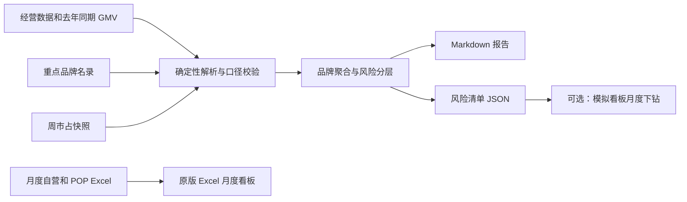

# 品牌市占分析 Agent

结合品牌经营同比、重点品牌名录与周市占走势，识别近三周市占持续走低的重点负增长品牌，输出**可复核的经营报告**和**结构化风险清单**。

仓库名建议：`brand-market-share-agent`。本仓库包含周度分析 Agent、原版 Excel 导入型月度看板，以及用于演示两者工作流的合成样例。Python CLI 无需大模型或企业账号；可选 Claude Code 子代理负责校验、提问、调用脚本和交付，指标计算不交给模型。

| 想做什么 | 入口 |
|---|---|
| 分析近三周市占持续走低并生成报告 | [`brand_agent.py`](brand_agent.py)，或 [.claude/agents/](.claude/agents/) 中的子代理 |
| 上传 Excel 底数，生成月度市占看板 | 下载仓库 ZIP 后打开 [`marketshare_app/marketshare_app.html`](marketshare_app/marketshare_app.html) |
| 导入 Agent 的 JSON，体验品牌月度下钻 | 下载仓库 ZIP 后打开 [`dashboard/index.html`](dashboard/index.html) |

## 60 秒快速开始：运行 Agent

**Python 3.10+**。在仓库根目录运行（Windows 下若 `python` 不可用，试 `py -3`）：

```bash
python brand_agent.py --gmv examples/gmv.csv --key-brands examples/key-brands.csv --weekly-share examples/weekly-share.csv --aliases examples/aliases.json --period "2025-12（模拟）" --share-source "本地模拟周市占" --expected-latest-week 2026-W01 --demo --out output
```

- `output/report.md`：分组统计、负增长品牌 Top 100、按 GMV 排序的深度卡片 Top 30 和经营缺口。
- `output/brand-risk-list.json`：**全部**负增长品牌的标记和证据，不受报告 Top N 截断。
- 可直接查看 [示例报告](examples/expected/report.md) 与 [示例风险清单](examples/expected/brand-risk-list.json)。所有样例都是虚构的。

## 打开原版 Excel 月度看板

1. 先下载并解压仓库 ZIP，不在 GitHub 源码预览里执行 HTML。用 Chrome 或 Edge 普通窗口打开 `marketshare_app/marketshare_app.html`。
2. 在 Excel 导入区同时选中 [`examples/dashboard-excel/monthly-owner-demo.xlsx`](examples/dashboard-excel/monthly-owner-demo.xlsx) 和 [`examples/dashboard-excel/monthly-pop-demo.xlsx`](examples/dashboard-excel/monthly-pop-demo.xlsx)。
3. 等数据装配完成，点「装配并查看看板」。也可上传符合原表结构的月度 Excel，见 [Excel 看板说明](marketshare_app/README.md)。

原看板 HTML 保持原样：**保留原品牌映射和页面文字，不预装真实经营数据**。原看板不直接读 Agent 的风险 JSON，也不会从月表反推周市占。导入后的数据留在浏览器本地；从真实底数生成的离线 HTML 或底座备份会带数据，不能当作公开文件分享。

## 体验风险清单下钻（可选）

打开 `dashboard/index.html`，点击「载入模拟清单」，或导入刚生成的 JSON。选「样例棱镜」看最新可用月；「样例风帆」演示周度缺数；「样例外圈」有风险标记，但模拟月度底座未收录。这个轻量看板只展示合成月度数据，不依赖 IndexedDB，不用于上传企业月表。

## 用自己的数据

| 输入 | 必需表头 | 说明 |
|---|---|---|
| 经营数据 `--gmv` | `brand,category,current_gmv,prior_year_gmv` | 品牌×类目金额（元），直接提供去年同期金额；同期单元格为空计 0，整列仍必需。 |
| 重点品牌 `--key-brands` | `brand` | 相同周期适用的重点品牌名单，至少一条。 |
| 周市占 `--weekly-share` | `week,brand,share` | 长表；周标签 `YYYY-Www` 或 `YYYY年第n周`。市占按 0–1 小数（如 `0.25`，最多 12 位小数），缺数留空，不能填 0。 |
| 别名 `--aliases`（可选） | JSON 对象 `{ "别名": "标准名" }` | 明确映射 + Unicode/大小写归一，不做模糊匹配。 |

支持 UTF-8 CSV（含 BOM），表头列序可变。XLSX 需要 `python -m pip install -r requirements-xlsx.txt`；以首行表头定位唯一工作表，公式请预先保存有效值或转为数值；原始导出列名不同，请在副本中映射成上述表头。实际经营分析不要传 `--demo`。若要防止导到了旧周快照，传 `--expected-latest-week YYYY-Www` 和真实来源名。**CLI 会覆盖输出目录中的两个同名文件**，建议每次用新的 `--out` 目录并将真实结果保存在仓库外；每个文件单独以原子写入替换，异常时以命令退出状态为准。

### 判定规则

1. 周窗口以输入中最新三条实际周标签为准，核对跨年仍连续；传入预期最新周时额外比对。品牌缺值与整个周窗口不连续分别处理。
2. 品牌同比 = `汇总本期 GMV ÷ 汇总去年同期 GMV − 1`。同期空值计 0；汇总同期为 0 记「无基数」，为负记「不可比」；正基期且两期相等记「持平」。重复品牌类目行、负值按原值聚合，报告记录这些情况，便于确认而不是静默纠正。
3. 经营同比为负、属于重点品牌、三个周值严格逐周下降才标「风险」（**两次周环比下降，到第三周确认**）。重点负增长未持续走低或缺数记「预警」并说明原因；非重点负增长记「次要」。
4. 深度卡片仍按**负增长品牌的总 GMV 降序取前 30**，与风险标记无关。周市占证据、经营类目缺口和月度下钻分开，不能用后两者证明周下滑原因。

## Claude Code 与可选集成

在仓库根目录打开支持项目子代理的 Claude Code 环境，调用 `brand-market-share-agent`（定义在 `.claude/agents/`），例如「用品牌市占分析 Agent 跑一次仓库样例，说明哪几个品牌触发风险」。各宿主权限和加载方式可能不同，CLI 是无宿主的基线。公开版**不包含 Joyspace 连接器，也不会自动发布**；[可选集成规范](docs/integrations.md)说明如何从已获授权的连接器读取并可选发布。

## 项目结构与复现



```text
brand_agent.py                        确定性输入解析、聚合、分层与输出
.claude/agents/brand-market-share-agent.md  模型编排与操作约束
examples/                             三份模拟输入、模拟月度 Excel 和预期输出
marketshare_app/                      原版 Excel 导入型月度看板（独立 HTML）
dashboard/                            可选、独立的风险清单联动演示
scripts/make_demo.py                  从零生成样例、期望产物和看板 HTML
tests/                                单元与命令行回归
.github/workflows/ci.yml              GitHub Actions 验证
```

```bash
python scripts/make_demo.py
python -m unittest discover -s tests -v
```

风险数据契约：[schema](docs/brand-risk-list.schema.json)。发布前核对事项见 [发布检查](docs/release-checklist.md)。原看板有独立的资产授权边界，不因与 Agent 一起打包而自动获得开源许可。本包未代你添加许可证、创建仓库或上传。
